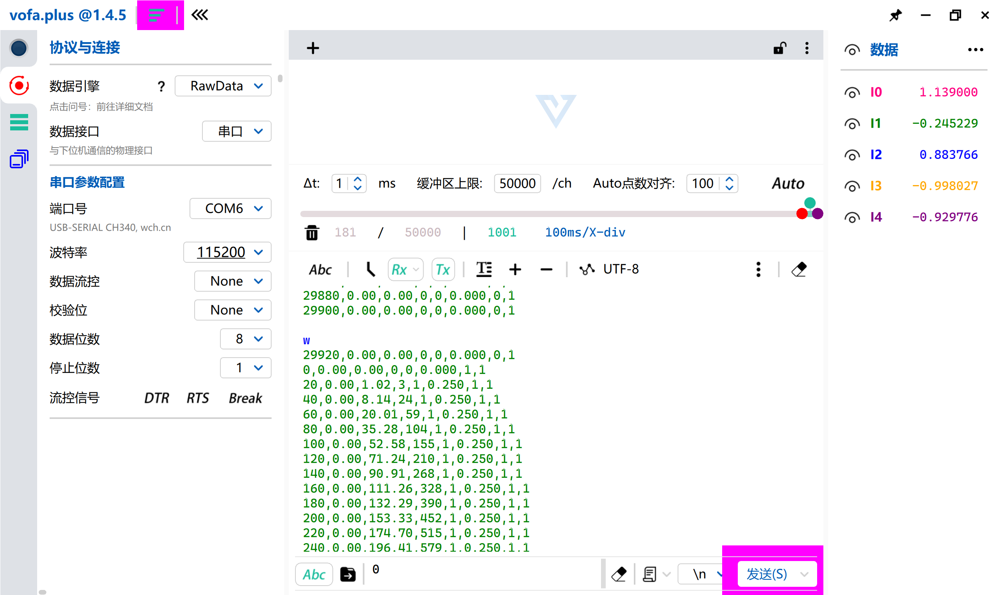
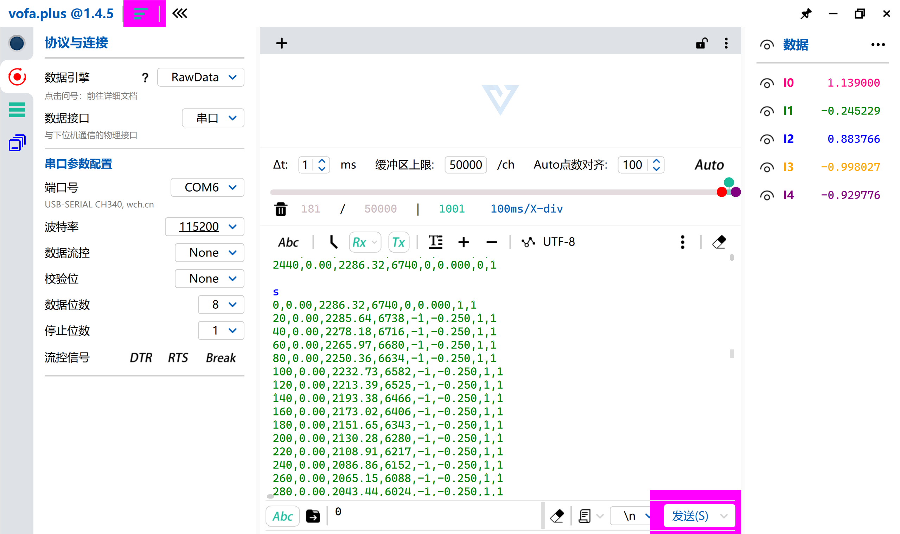
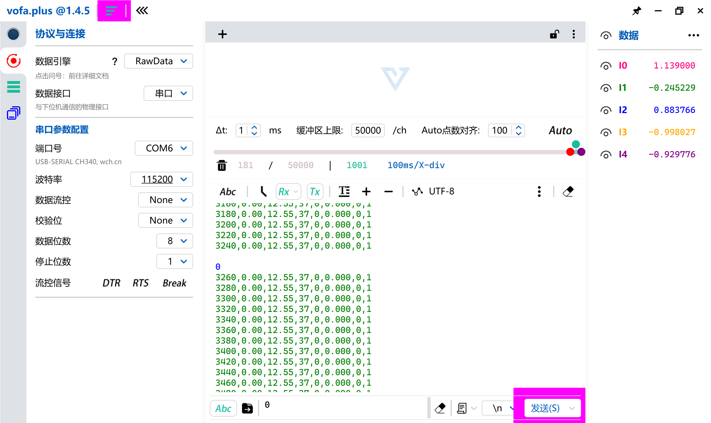
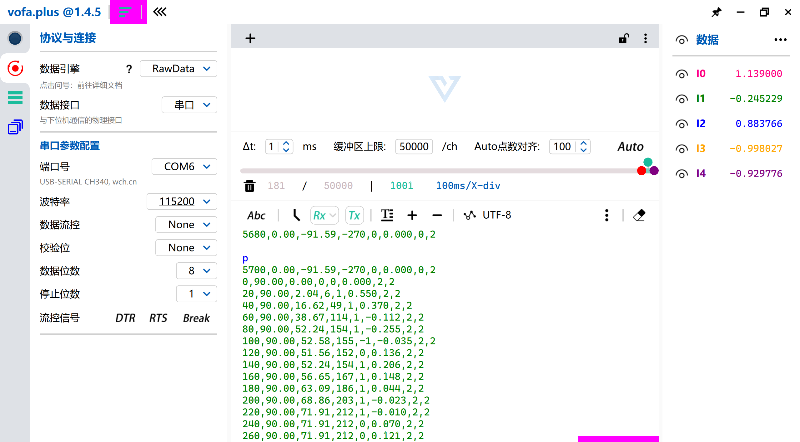
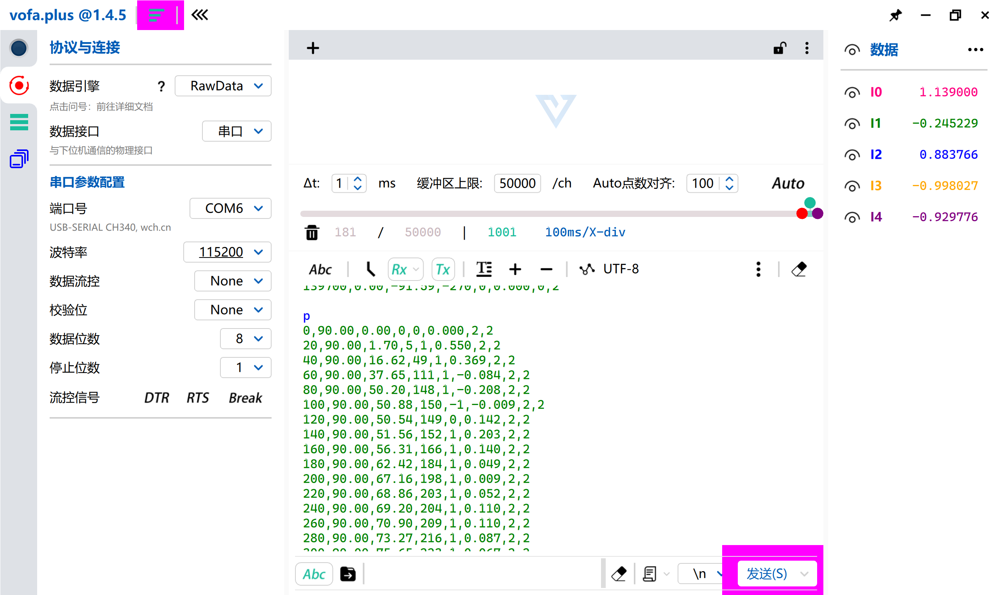
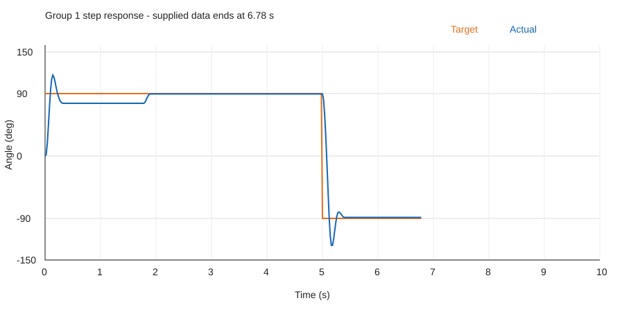
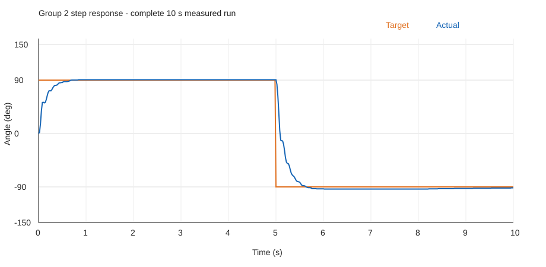

# 任务完成简述

## 任务一 硬件搭建与开环控制

正确连接 STM32、TB6612、电机及供电模块，使用 PWM 实现：

1. 电机正转、反转、停止。

2. 通过改变 PWM 占空比调节电机速度（至少展示两档）。

	| 指令 | 效果          |
	| ---- | ------------- |
	| w    | 正转，25% PWM |
	| e    | 正转，45% PWM |
	| s    | 反转，25% PWM |
	| d    | 反转，45% PWM |
	| x    | 停止          |


## 任务二 编码器读取

使用 STM32 定时器编码器模式读取反馈数据：

1. 能够读取编码器计数并判断转动方向。
2. 能够根据编码器计数变化计算电机输出轴相对于初始位置的累计转角。
3. 通过串口、VOFA 或 OLED 等方式展示位置变化。

注意编码器倍频、减速比、计数方向和计数器溢出等问题。









## 任务三 PID 位置闭环

使用 C/C++ 实现位置式 PID，并完成电机位置闭环：

1. 使用结构体或类保存 PID 参数及状态，支持参数修改与输出限幅。
2. 以相对稳定的周期读取反馈、计算 PID，并输出电机方向与 PWM。
3. 电机能自动运动到**至少两个不同目标位置**（如 90°、-90°），并在目标附近基本保持稳定。

可采用定时器中断、RTOS 周期任务或合理的主循环调度；不要求在线输入目标位置。建议先尝试 P 控制，再完善 PID。


| 时间    | 运动                  |
| ------- | --------------------- |
| 0～5秒  | 运动到 `+90°`，并保持 |
| 5～10秒 | 运动到 `−90°`，并保持 |
| 10秒后  | 停止驱动              |







## 任务四：工程结构与封装

合理组织工程，避免将所有业务逻辑堆在 `main.c`。建议分离以下职责：

| 模块    | 主要职责               | 接口示意                           |
| ------- | ---------------------- | ---------------------------------- |
| Motor   | PWM、方向、停止        | `Motor_SetOutput(output)`          |
| Encoder | 读取计数、换算位置     | `Encoder_GetPosition()`            |
| PID     | 根据目标与反馈计算输出 | `PID_Update(target, feedback, dt)` |
| Control | 周期性连接上述模块     | 自行设计                           |

**控制流程：** 目标位置 → PID → 电机驱动 → 电机 → 编码器反馈 → PID。


### PID 控制代码说明

#### 1.指令

| 指令      | 功能                                            |
| --------- | ----------------------------------------------- |
| `w` / `e` | 正向 25% / 45%                                  |
| `s` / `d` | 反向 25% / 45%                                  |
| `x`       | 立即退出测试并关断驱动                          |
| `z`       | 空闲时以当前编码器位置清零                      |
| `1` / `2` | 停止当前测试并选参数组 1 / 2                    |
| `p`       | 以启动位置为 0°，跟踪 +90° 5 s，再跟踪 −90° 5 s |
| `t`       | 以启动位置为 0°，执行 20 s 正弦跟踪             |

开环指令每次持续 2 秒，重新发送会重新计时。复位进入空闲，只有收到运行命令才驱动电机。测试结束后 STBY 拉低，输出轴可随惯性滑行。

#### 2.串口数据

设备约每 20 ms 发送一行，无表头。试验时按 `mode` 筛选数据，并选择同一轮从时间复位到测试结束的区间。

```text
time_ms,target_deg,actual_deg,count,dir,output,mode,group
```

`dir` 为最近一次约 10 ms 采样间隔内的净方向，取 −1、0 或 +1。`output` 为有符号占空比，0.45 表示正向 45%。`mode` 依次为 0 空闲、1 开环、2 阶跃、3 正弦，`group` 为 1 或 2。开环和空闲的目标列为 0。每次运行的时间从命令开始计，画图时将 `time_ms` 除以 1000 得到秒。

#### 3.拆分

| 文件                    | 内容                                                         |
| ----------------------- | ------------------------------------------------------------ |
| `App/AppConfig.h`       | 全局硬件及时间常量。集中配置 PID 周期、记录周期、PWM 频率、串口波特率、编码器比例和方向、输出限幅。 |
| `App/Motor.h`           | 声明初始化、归一化有符号输出和停止三个接口。                 |
| `App/Motor.c`           | 配置 GPIO 和 TIM3_CH1。按 APB1 的分频规则求定时器时钟，用计数周期与 PWM 频率换算 ARR。输出正负决定 AIN1/AIN2，绝对值乘周期计数得到 CCR1。换向时先拉低 STBY，再更新方向和载入新占空比，最后恢复驱动。停止时拉低 STBY 并将比较值归零。 |
| `App/Encoder.h`         | 声明初始化、清零、采样及累计计数、方向和位置读取接口。       |
| `App/Encoder.c`         | 配置 TIM2 的 TI12 编码器模式与双路数字滤波。将相邻 CNT 差值按 65536 取模并映射到有符号范围，以 64 位计数累计。清零时同步读入当前 CNT。输出角度为累计计数乘以 360 再除以每圈计数。 |
| `App/PID.h`             | `PID_Params` 保存三项增益与输出限制，`PID` 另存积分、上次角度和滤波速度。声明重置和更新接口，模块可独立于 STM32 外设使用。 |
| `App/PID.c`             | 计算位置误差、按实际 dt 积分、估算并滤波实际速度。输出由比例、积分和反馈微分相加，做对称限幅。若本次积分会推动输出继续进入饱和，保留原积分。 |
| `App/Serial.h`          | 声明 USART 初始化、读字符、发送轮询和提交完整日志行的接口。  |
| `App/Serial.c`          | 配置 USART1 和 PA9/PA10。RX 有数据才读，TX 空闲才写一个字节。两行日志缓冲都忙时，控制层可以跳过一条日志，避免等串口发送。 |
| `App/Control.h`         | 声明初始化、解析命令、周期调度三个入口。                     |
| `App/Control.c`         | 管理四种模式和两组增益。新测试重置 PID，闭环同时重置编码器原点。周期内依次采样、计算目标、计算输出、驱动并记录。运行超时后自动回空闲。两次控制间隔超过 30 ms 时停止驱动。 |
| `User/main.c`           | 更新系统时钟，顺序初始化各模块。SysTick 每 1 ms 递增计时。主循环持续轮询串口和控制，不使用延时等待。 |
| `User/stm32f10x_it.h`   | 声明 Cortex-M3 异常处理接口。                                |
| `User/stm32f10x_it.c`   | 沿用 ST 异常处理模板，硬故障、内存管理故障、总线故障和用法故障进入死循环前调用 `Motor_Stop`。SysTick 实现在 main.c。 |
| `User/stm32f10x_conf.h` | 标准外设库的统一头文件入口和 `assert_param` 配置。           |
| .gitignore              | 忽略 Keil 生成的构建、调试和个人设置文件。                   |
| Motor_PID.uvprojx       | Keil 工程目标、存储布局、宏、头文件路径和源码清单。          |


## 任务五：PID 调参与实验记录

1. 至少测试**两组不同 PID 参数**，记录目标位置与实际位置的响应曲线。

2. 比较响应速度、超调、振荡或稳态误差等现象。

3. 记录最终参数和简短的调参思路。

	

在相同电源、负载和起始条件下，用参数组 1 和 2 分别发送 `p`。横轴用时间（s），纵轴用角度（°），每张图叠加目标与实际角度。测试从 +90° 开始，5 s 切换到 −90°，10 s 停止驱动。

| 组别  |    Kp |    Ki |    Kd | 最大占空比 | 实测比较                                                     |
| ----- | ----: | ----: | ----: | ---------: | ------------------------------------------------------------ |
| 1. P  | 0.007 |     0 |     0 |        55% | +90°峰值116.69°，后段89.55°。−90°最低−128.90°，后段−88.54°。数据到6.78s |
| 2.PID | 0.009 | 0.006 | 0.001 |        55% | +90°最高90.57°，后段90.57°。−90°最低−93.62°，9.5–9.98s实际−92.27～−91.59°，数据到10s |





